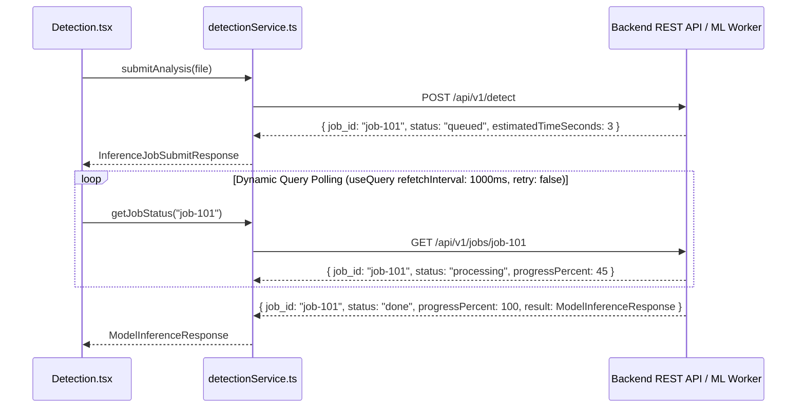

# ArecaVision AI — Backend & ML Model Integration Guide

This document defines the REST API contract, request/response payload shapes, authentication strategy, async ML inference polling lifecycle, optimistic state rollbacks, and code integration points for connecting a real backend service to the ArecaVision AI frontend.

---

## 1. Environment & Architecture Configuration

The frontend uses an environment-driven service layer with a mock/real API adapter pattern.

### Environment Variables (`.env`)
```bash
# Backend Base URL for real HTTP REST requests
VITE_API_BASE_URL=http://localhost:8000/api/v1

# Toggle feature flag (set to 'false' to route requests to VITE_API_BASE_URL)
VITE_USE_MOCK_DATA=true

# Dev error simulation probability (0.0 to 1.0)
VITE_MOCK_ERROR_RATE=0.0
```

> [!NOTE]
> **Mock Error Simulation & Background Polling**:
> Background 10-second polling calls (such as `useNotifications`) use `bypassErrorSimulation: true` to prevent noisy background error banners from flickering every 10s while testing feature pages with `VITE_MOCK_ERROR_RATE > 0`.

---

## 2. Authentication Flow

### Strategy & Token Handling
- **Recommended Strategy (Production)**: **httpOnly Cookies** (`SameSite=Strict`).
  - Browser automatically manages cookie transmission.
  - Eliminates XSS JWT token theft risks.
- **Fallback / Dev Strategy (Bearer Header)**:
  - If `/auth/login` returns a `token` field, `apiClient.ts` stores it in `localStorage` under `arecavision_auth_token` and injects `Authorization: Bearer <token>` into all outgoing API requests.

### 401 Unauthorized Interceptor
If any API endpoint returns HTTP status `401 Unauthorized`, `apiClient.ts` triggers a global event to `AuthContext`, clearing the user state and cleanly redirecting the user to `/login` without infinite loop bugs.

---

## 3. Async Job-Based ML Inference Engine

Due to the heavy compute latency of CNN + Vision Transformer + YOLOv8 ensemble models, image diagnosis does **NOT** use a single blocking synchronous request. Instead, it follows a 2-phase async job pattern:



### Polling vs Global Retry Rule
- The polling query (`getJobStatus`) explicitly sets `retry: false` to override the global default `retry: 1`. This prevents backoff delays when polling active job statuses while `refetchInterval` automatically continues polling until status reaches `done` or `failed`.

### Client-Side Cancellation Semantics
- Clicking **"Cancel Processing"** in the UI executes `AbortController.abort()`, stopping client HTTP polling and discarding pending state.
- Optional REST hook: `POST /api/v1/jobs/:id/cancel` is called to allow backends supporting task preemption to halt model worker compute.

---

## 4. State Ownership & Optimistic Mutation Rollbacks

1. **State Ownership Split**:
   - **TanStack Query (Server State)**: Owns all server data fetching, caching, invalidation, stale management, and mutations (including `AIAssistant.tsx` chat history via `useQuery(['chatHistory'])`).
   - **Contexts (React Wrapper Layer)**: Act as clean React hook adapters (`useScanHistory`, `useNotifications`, `usePlantation`) wrapping query/mutation calls.

2. **Optimistic Mutation Rollback Pattern**:
   - When executing server mutations (e.g. `addScan`, `deleteScan`, `addBlock`):
     - `onMutate`: Call `await queryClient.cancelQueries({ queryKey: [...] })` and capture snapshot `previousData = queryClient.getQueryData(...)`.
     - Optimistically update cache: `queryClient.setQueryData([...], (old) => ...)`.
     - `onError`: Revert to snapshot: `queryClient.setQueryData([...], context.previousData)`.
     - `onSettled`: Invalidate cache: `queryClient.invalidateQueries({ queryKey: [...] })`.

---

## 5. Expected REST API Endpoints Specification

| Method | Endpoint | Description | Request Payload | Response Payload |
|---|---|---|---|---|
| `POST` | `/api/v1/auth/login` | Authenticate user | `LoginRequest` | `ApiResponse<AuthResponse>` |
| `POST` | `/api/v1/auth/logout` | End user session | None | `ApiResponse<void>` |
| `POST` | `/api/v1/auth/refresh` | Refresh auth token | `RefreshTokenRequest` | `ApiResponse<AuthResponse>` |
| `POST` | `/api/v1/detect` | Submit plant photo for ML diagnosis | `FormData(image)` or `{ imageUrl: string }` | `ApiResponse<InferenceJobSubmitResponse>` |
| `GET` | `/api/v1/jobs/:id` | Poll ML inference status | None | `ApiResponse<InferenceJobStatusResponse>` |
| `POST` | `/api/v1/jobs/:id/cancel` | Cancel active inference job | None | `ApiResponse<void>` |
| `GET` | `/api/v1/dashboard/kpi` | Fetch dashboard KPI statistics | None | `ApiResponse<KPIStatsResponse>` |
| `GET` | `/api/v1/dashboard/trends` | Fetch disease historical trend data | None | `ApiResponse<DiseaseTrendItem[]>` |
| `GET` | `/api/v1/dashboard/distribution` | Fetch disease breakdown distribution | None | `ApiResponse<DiseaseDistributionItem[]>` |
| `GET` | `/api/v1/plantation/summary` | Fetch plantation summary & blocks | None | `ApiResponse<PlantationSummaryResponse>` |
| `POST` | `/api/v1/plantation/blocks` | Add new plantation block | `Omit<PlantationBlockData, "health">` | `ApiResponse<PlantationBlockData>` |
| `DELETE` | `/api/v1/plantation/blocks/:id` | Delete plantation block | None | `ApiResponse<void>` |
| `GET` | `/api/v1/notifications` | Fetch alert notifications | None | `ApiResponse<NotificationResponse>` (contains `NotificationItemData[]` + `unreadCount`) |
| `PUT` | `/api/v1/notifications/read-all` | Mark all alerts as read | None | `ApiResponse<void>` |
| `GET` | `/api/v1/weather` | Proxied weather metrics | `?city=Madikeri&lat=12.42&lon=75.73` | `ApiResponse<WeatherApiResponse>` |
| `POST` | `/api/v1/reports/export` | Export PDF or CSV report blob | `ReportGenerateRequest` | `ReportExportBlob` (Binary file stream) |
| `GET` | `/api/v1/assistant/history` | Fetch chat history | None | `ApiResponse<ChatMessageItem[]>` |
| `POST` | `/api/v1/assistant/chat` | AI Chat Assistant query | `AssistantChatRequest` | `ApiResponse<AssistantChatResponse>` |

---

## 6. Manual QA Verification Flow Checklist

1. **Mock Error Rate Testing**:
   - Set `VITE_MOCK_ERROR_RATE=0.5` in `.env`.
   - Refresh `/dashboard` or submit an image on `/detection` to verify error banners and Retry action buttons render and function properly on failures.
2. **Async Job Polling Walkthrough**:
   - Upload image on `/detection` -> verify step indicator moves from `queued` (15%) -> `processing` (85%) -> `done` (100%), rendering diagnosis & XAI overlays.
3. **Request Cancellation Test**:
   - Click "Cancel Processing" while job is in `processing` status -> verify `AbortController.abort()` cancels poll request and resets UI state.
4. **Report Export Test**:
   - Navigate to `/reports` and click "Export PDF" or "Export CSV" -> verify file download triggers in browser.
5. **AI Assistant Query-Cache Test**:
   - Navigate to `/assistant`, type a question, and submit -> verify message history is stored in TanStack Query cache.
