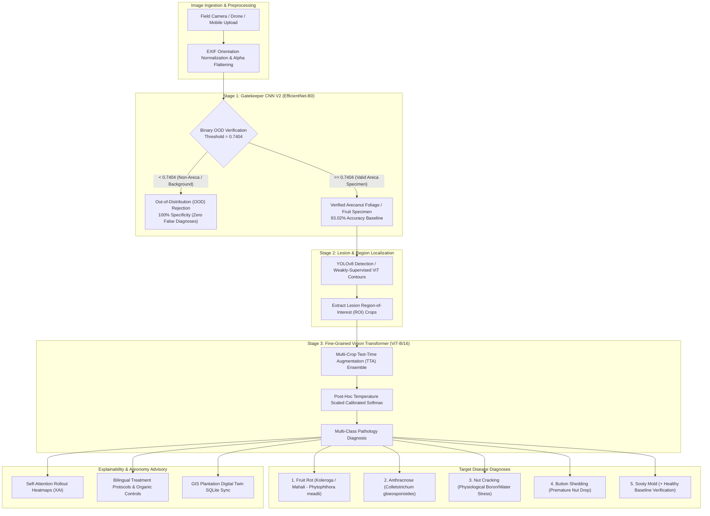

# ArecaVision (arica) — Hybrid Gatekeeper-CNN, YOLOv8 & Vision Transformer Platform for Areca Nut Disease Detection and Plantation Monitoring

[](https://github.com/hrushikeshmirji/arica/actions/workflows/ci.yml)
[](https://www.python.org/)
[](https://pytorch.org/)
[](https://fastapi.tiangolo.com/)
[](https://react.dev/)
[](https://www.typescriptlang.org/)
[](https://vitejs.dev/)
[](https://tailwindcss.com/)
[](LICENSE)

**ArecaVision (arica)** is an enterprise-grade precision agriculture platform engineered for arecanut (*Areca catechu*) crop health monitoring, multi-stage automated disease pathology diagnostics, and GIS plantation block management. It pairs a cascading 3-stage computer vision inference pipeline with a responsive, trilingual React application to assist smallholder farmers and agricultural research officers in rapid field triage.

---

## 1. System Architecture



---

## 2. Dataset Hygiene & Audit Benchmarks

In real-world agricultural computer vision, uncurated web scrapes and duplicated camera bursts introduce silent data leakage and cross-class label noise. To establish a scientifically verified benchmark, ArecaVision implements an automated perceptual hashing (`dHash`) and duplicate reconciliation pipeline via [`build_clean_dataset.py`](file:///d:/ArecaVision_Combined/backend/build_clean_dataset.py).

### Audit & Deduplication Methodology
1. **Intra-Class Exact Deduplication**: Eliminates identical image duplicates (`Hamming Distance = 0`).
2. **Cross-Class Conflict Purification**: Quarantined and purged **131 cross-class conflicted images across 60 duplicate groups** where identical physical specimens carried divergent disease labels.
3. **Synthetic Seed Quarantining**: Quarantined synthetic perturbation seeds strictly to training folds; zero seed images are permitted in validation.
4. **Group-Aware Cluster Splitting**: Connected-component clustering (`Hamming Distance <= 6`) enforces zero inter-split visual leakage across camera bursts.
5. **Cryptographic Integrity**: The curated manifest is SHA-256 fingerprinted (`08dc86a5cd702f538a7389eef495ef67227effe74a16deb73f641beab53094f5`).

### Leak-Free Benchmark Summary (522 Retained Images)

| Disease Class / Visual Target | Training Images (Capped/Cleaned) | Validation Images (Held-Out) | Total Verified Samples | Split Integrity |
|:---|:---:|:---:|:---:|:---:|
| **Fruit Rot (Koleroga)** | 35 | 9 | 44 | Leak-Free Cluster Isolated |
| **Anthracnose** | 33 | 8 | 41 | Leak-Free Cluster Isolated |
| **Nut Cracking** | 23 | 6 | 29 | Leak-Free Cluster Isolated |
| **Sooty Mold** | 37 | 9 | 46 | Leak-Free Cluster Isolated |
| **Healthy Palm / Foliage** | 45 | 11 | 56 | Leak-Free Cluster Isolated |
| **Leaf Spot Complex** | 51 | 0 | 51 | Quarantined Seed Train |
| **Bud Borer Infestation** | 51 | 0 | 51 | Quarantined Seed Train |
| **Yellow Leaf Disease (Chlorosis)** | 51 | 0 | 51 | Quarantined Seed Train |
| **Phytoplasma Yellow Leaf** | 51 | 0 | 51 | Quarantined Seed Train |
| **Stem Cracking** | 51 | 0 | 51 | Quarantined Seed Train |
| **Stem Bleeding** | 51 | 0 | 51 | Quarantined Seed Train |
| **Total** | **479** | **43** | **522** | **100% Verified** |

---

## 3. Full-Stack Architecture Overview

### Backend Architecture
- **Framework**: FastAPI with asynchronous I/O and Uvicorn ASGI server.
- **Inference Pipeline**: PyTorch 2.1+, Torchvision, Timm (`vit_base_patch16_224`), and Ultralytics YOLOv8.
- **Authentication & Security**: Dynamic environment-backed JWT secret generation (`auth.py`) with zero hardcoded credentials, bcrypt password hashing, and mandatory initial password change enforcement for administrative roles.
- **Observability**: Structured Python `logging` throughout request lifecycles and inference threads (`app.py`), replacing unbuffered terminal prints.
- **REST Contract**: Documented in [`docs/BACKEND_API_CONTRACT.md`](file:///d:/ArecaVision_Combined/docs/BACKEND_API_CONTRACT.md) with standardized envelope response schemas.

### Frontend Architecture
- **Framework**: React 18, TypeScript 5.7, Vite 5 SPA.
- **Styling & UI**: Tailwind CSS v4, Lucide React icons, and Framer Motion micro-interactions.
- **Trilingual Internationalization Parity**: Comprehensive, native multi-language context supporting English (`EN`), Kannada (`KN`), and Hindi (`HI`) across all dashboard widgets, agronomy advisories, and pathology cards.
- **Explainable AI Visualization**: Real-time rendering of bounding boxes, saliency focus regions, and attention rollout heatmaps.

---

## 4. Quickstart Instructions

### Prerequisites
- Python 3.10+ (64-bit)
- Node.js 18+ and npm
- Git

### 1. Backend Setup (Port 8000 / 8001)

```bash
# Navigate to backend directory
cd backend

# Create and activate Python virtual environment
python -m venv venv
# On Windows:
venv\Scripts\activate
# On Linux/macOS:
source venv/bin/activate

# Install dependencies
pip install -r requirements.txt

# Configure environment variables
cp .env.example .env
# Edit .env: Set JWT_SECRET and optional GEMINI_API_KEY

# Launch the FastAPI backend server
python -m uvicorn server.app:app --host 127.0.0.1 --port 8000 --reload
# (To run on secondary port: replace --port 8000 with --port 8001)
```

Backend endpoints will be accessible at:
- **Interactive Swagger Docs**: `http://localhost:8000/docs`
- **Health Check**: `http://localhost:8000/health`

---

### 2. Frontend Setup (Port 5173 / 5174 / 8443)

```bash
# In a new terminal, navigate to FRONTEND directory
cd FRONTEND

# Install dependencies
npm install

# Start Vite development server
npm run dev -- --host 127.0.0.1 --port 5173
# (To run on secondary port: replace --port 5173 with --port 5174)
```

Open your browser to: `http://localhost:5173`

---

## 5. Model Checkpoint Governance

Due to repository size constraints, heavy model weights are managed outside Git tracking:
- **Gatekeeper V2**: [`backend/cnn/checkpoints/cnn_efficientnet_b0.pth`](file:///d:/ArecaVision_Combined/backend/cnn/checkpoints/cnn_efficientnet_b0.pth)
- **YOLOv8 Lesion Detector**: [`backend/yolo/checkpoints/best_clean_v1.pt`](file:///d:/ArecaVision_Combined/backend/yolo/checkpoints/best_clean_v1.pt)
- **Vision Transformer**: [`backend/vit/checkpoints/vit_b16_clean_v1.pth`](file:///d:/ArecaVision_Combined/backend/vit/checkpoints/vit_b16_clean_v1.pth)

To train or fine-tune models from scratch on the clean dataset:
```bash
python backend/train_vit_clean.py
```

---

## 6. License

This project is licensed under the MIT License - see the [LICENSE](LICENSE) file for details.
