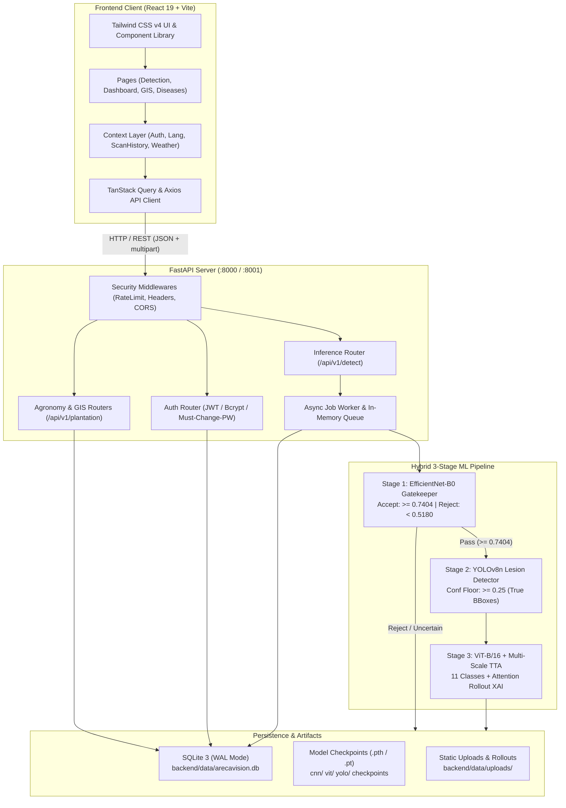
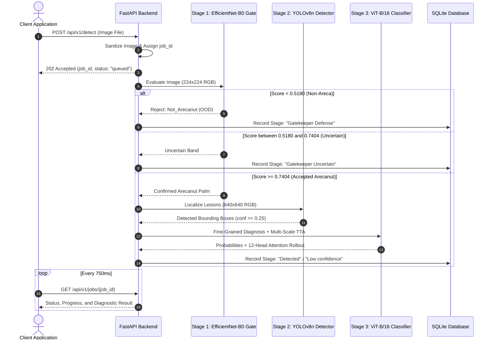

# ArecaVision 2.0 — System Architecture

## 1. Executive Summary

ArecaVision AI 2.0 is an enterprise-grade precision agriculture diagnostic platform engineered for arecanut (*Areca catechu*) crop management. The platform combines a responsive React 19 web application with an asynchronous FastAPI microservice powered by a 3-stage hybrid deep learning inference pipeline:

1. **Stage 1 — EfficientNet-B0 Gatekeeper**: Filters non-arecanut inputs and out-of-distribution imagery using calibrated dual acceptance/rejection thresholds.
2. **Stage 2 — YOLOv8n Lesion Detector**: Pinpoints pathological regions and bounding boxes on the palm tissue with strict confidence floors.
3. **Stage 3 — ViT-B/16 Fine-Grained Classifier**: Conducts multi-scale Test-Time Augmentation (TTA) classification across 11 crop disease categories, coupled with 12-head attention rollout explainability (XAI).

---

## 2. High-Level Architecture Diagram



---

## 3. Frontend Architecture

### 3.1 Technology Stack
- **Framework**: React 19 (`react` 19.0.0, `react-dom` 19.0.0)
- **Tooling & Bundler**: Vite 8.0.0, TypeScript 5.7.0
- **Styling**: Tailwind CSS v4 (`@tailwindcss/vite` 4.0.0) with Lucide Icons (`lucide-react`)
- **State Management & Data Fetching**: TanStack Query (`@tanstack/react-query` 5.101.4)
- **Routing**: React Router DOM (`react-router-dom` 7.18.2)
- **Visualizations & Motion**: Recharts (`recharts` 3.10.1), Framer Motion (`framer-motion` 12.43.0)
- **Testing**: Vitest (`vitest` 4.1.10), Testing Library (`@testing-library/react` 16.3.2)

### 3.2 Directory Hierarchy (`FRONTEND/src/`)
```
FRONTEND/src/
├── components/          # Shared atomic components, modals, and navigation
│   ├── CommandPalette.tsx        # Global search and keyboard shortcut launcher
│   ├── ErrorBoundary.tsx         # Root error catchment and UI fallback
│   ├── Layout.tsx                # Master app shell, sidebar navigation, top bar
│   ├── LiveCameraModal.tsx       # WebRTC real-time palm capture
│   ├── MarkTreatmentModal.tsx    # Treatment tracking logger for GIS blocks
│   ├── ProtectedRoute.tsx        # JWT and must_change_password route guard
│   ├── ThemeToggle.tsx           # Dark/Light theme switcher
│   ├── TreatmentCalculatorModal. # Dosage and pesticide calculator
│   └── XaiSplitViewer.tsx        # Side-by-side ViT attention map viewer
├── contexts/            # Global React contexts
│   ├── AuthContext.tsx           # User identity, JWT storage, login/logout
│   ├── LanguageContext.tsx       # Trilingual i18n (English, Kannada, Hindi)
│   ├── NotificationContext.tsx   # Epidemiological toast and banner alerts
│   ├── PlantationContext.tsx     # GIS Digital Twin blocks and telemetry
│   ├── ScanHistoryContext.tsx    # Diagnostic session records
│   ├── ThemeProvider.tsx         # Dark/Light theme class injection
│   └── WeatherContext.tsx        # Environmental telemetry and disease risk
├── pages/               # Top-level route views
│   ├── Admin.tsx                 # System audit logs, user management, DB backup
│   ├── AIAssistant.tsx           # Agronomic AI consultant chat interface
│   ├── Analytics.tsx             # Disease distribution charts & KPI trends
│   ├── Dashboard.tsx             # Executive overview, active alerts, quick actions
│   ├── Detection.tsx             # Primary diagnostic upload, scan progress, report
│   ├── Diseases.tsx              # Comprehensive pathological disease library
│   ├── Landing.tsx               # Public landing page with specimen gallery
│   ├── Login.tsx                 # Authentication form & password update modal
│   ├── Notifications.tsx         # Notification notification feed
│   ├── PlantationMap.tsx         # Interactive SVG GIS plantation digital twin
│   ├── Reports.tsx               # Clinical diagnostic report generator & PDF/CSV
│   ├── Research.tsx              # Model architectures, benchmark telemetry
│   ├── RiskForecast.tsx          # Spatiotemporal disease propagation forecasting
│   ├── ScanHistory.tsx           # Filterable diagnostic scan archive
│   ├── Settings.tsx              # User preferences, locale, theme options
│   └── Weather.tsx               # Microclimate monitoring & humidity charts
├── services/            # Axios API integration clients
│   ├── apiClient.ts              # Axios instance with auth interceptor
│   ├── authService.ts            # Authentication & password management
│   ├── detectionService.ts       # Job submission, status polling, cancellation
│   ├── dashboardService.ts       # Telemetry & KPI queries
│   ├── plantationService.ts      # GIS block updates & disease status
│   └── weatherService.ts         # Weather data & risk forecast queries
└── utils/               # Formatting, safe storage, speech synthesis
```

### 3.3 State Management & Localization
- **Asynchronous Data**: Managed through TanStack Query (`useQuery`, `useMutation`), ensuring query caching, background polling, and optimistic updates.
- **Trilingual Localization (`LanguageContext.tsx`)**: Fully localized across English (`en`), Kannada (`kn`), and Hindi (`hi`), covering clinical notices, treatment recommendations, UI labels, and retake prompts.
- **Route Protection (`ProtectedRoute.tsx`)**:
  - Restricts private routes (`/dashboard`, `/history`, `/analytics`, `/admin`, etc.) to authenticated users with valid JWTs.
  - Enforces `must_change_password` check: redirects newly seeded accounts with temporary passwords directly to the password change flow.
  - Permits public access to `/`, `/detection`, and `/diseases`.

---

## 4. Backend Architecture

### 4.1 Framework & Concurrency
- **Microservice**: FastAPI (`fastapi` 0.110+) running under Uvicorn ASGI.
- **Concurrency Model**: Asynchronous I/O (`asyncio`) for network and database operations combined with multi-threaded background processing (`threading.Thread`) for computationally intensive PyTorch GPU/CPU inference.
- **Job Processing Lifecycle**:
  - Client submits an image via `POST /api/v1/detect`.
  - Backend performs image sanitization and validation, enqueues the job into `jobs` table with `status="queued"`, and immediately returns `202 Accepted` with a unique `job_id`.
  - Background worker thread executes the 3-stage ML pipeline, updating `stage` and `progressPercent` in the SQLite database.
  - Frontend polls `GET /api/v1/jobs/{job_id}` at 750ms intervals until completion or failure.

### 4.2 Security Architecture (`backend/server/security.py`)
- **Authentication**: JWT tokens signed using HMAC-SHA256 (`HS256`) with configurable expiration (`ACCESS_TOKEN_EXPIRE_MINUTES`).
- **Password Hashing**: Passwords stored using salted Bcrypt hashes via Python `bcrypt` (`bcrypt.gensalt()`, `bcrypt.hashpw()`, `bcrypt.checkpw()`).
- **Token Revocation**: Stateful blacklist table (`revoked_tokens`) checked on every authenticated request.
- **Input Sanitization**:
  - Upload file size capped at 10 MB (`_MAX_UPLOAD_BYTES`).
  - Image header validation verifying MIME types against PIL formats (`JPEG`, `PNG`, `WEBP`, `BMP`).
  - Image decompressed and re-encoded in memory to strip malicious EXIF/polyglot payloads.
- **Middleware Protections**:
  - `RateLimitingMiddleware`: Token bucket IP-based rate limiting on sensitive endpoints.
  - `SecurityHeadersMiddleware`: Injects `X-Content-Type-Options: nosniff`, `X-Frame-Options: DENY`, `X-XSS-Protection: 1; mode=block`, and strict CORS policies.

---

## 5. 3-Stage Hybrid ML Pipeline

### 5.1 Pipeline Stage Breakdown



### 5.2 Stage 1: EfficientNet-B0 Gatekeeper
- **Model**: `EfficientNet-B0` (`cnn/checkpoints/cnn_efficientnet_b0.pth`), pre-trained on ImageNet and fine-tuned on binary Arecanut vs. Non-Arecanut crops.
- **Input Dimensions**: $224 \times 224$ pixels, RGB normalized to ImageNet statistics.
- **Calibrated Decision Boundary**:
  $$\text{Gate Decision} = \begin{cases} 
  \text{Accept (Arecanut)}, & P(\text{areca}) \ge 0.7404 \\
  \text{Uncertain (Suspended)}, & 0.5180 \le P(\text{areca}) < 0.7404 \\
  \text{Reject (Gatekeeper Defense)}, & P(\text{areca}) < 0.5180 
  \end{cases}$$
- **Behavior**:
  - Rejection terminates the pipeline immediately, protecting downstream classifiers from processing out-of-domain imagery.
  - Uncertain inputs suspend diagnosis to prevent misclassification and advise the user to retake the photo.

### 5.3 Stage 2: YOLOv8n Lesion Detector
- **Model**: `yolov8n` (`yolo/checkpoints/best.pt`), Ultralytics PyTorch architecture.
- **Input Dimensions**: $640 \times 640$ pixels.
- **Inference Rules**:
  - Detections filtered strictly to $\text{confidence} \ge 0.25$.
  - Output bounding boxes reported as true percentage-based coordinates (`top`, `left`, `width`, `height`).
  - When no lesions meet the confidence threshold, the model falls back to a saliency heuristic box clearly labeled `"saliency heuristic (not a trained detector)"` with no fake confidence percentage.

### 5.4 Stage 3: ViT-B/16 Classifier & Multi-Scale TTA
- **Model**: Vision Transformer `vit_base_patch16_224` via `timm` (`vit/checkpoints/vit_b16.pth`).
- **Inference Enhancements**:
  - **Multi-Scale Test-Time Augmentation (TTA)**: Evaluates image at scales $[1.0, 0.9, 1.1]$ with horizontal flips.
  - **Temperature Scaling**: Softmax calibrated with temperature $T = 1.15$.
  - **Explainability (XAI)**: Generates 12-head attention rollout heatmaps visualizing the model's spatial decision drivers.
- **Disease Categories (11 Classes)**:
  - **Validated Field Classes (5)**: `Anthracnose`, `FruitRot` (Koleroga), `Healthy`, `NutCracking`, `SootyMold`.
  - **Experimental / Synthetic Classes (6)**: `BudBorer`, `LeafSpotComplex`, `PhytoplasmaYellowLeaf`, `StemBleeding`, `StemCracking`, `YellowLeaf`.
- **Confidence Floors**:
  - Disease classes require $\text{Top-1} \ge 50.0\%$ and $(\text{Top-1} - \text{Top-2}) \ge 10.0\%$.
  - Healthy class requires $\text{Top-1} \ge 70.0\%$ and $(\text{Top-1} - \text{Top-2}) \ge 25.0\%$.
  - Below these thresholds or on experimental classes, the stage is clamped to `"Low confidence"`, blocking prescriptive chemical treatments and advising agronomic consultation.

---

## 6. Persistence & Storage Layer

### 6.1 Database Engine
- **Engine**: SQLite 3 with Write-Ahead Logging (`WAL`) enabled.
- **Configuration**:
  - `PRAGMA journal_mode = WAL;` (Enables concurrent readers and single writer without read locks).
  - `PRAGMA synchronous = NORMAL;` (Ensures durability while eliminating fsync bottlenecks).
  - Thread-safe connection pooling protected via Python `threading.Lock`.
- **Primary Data Path**: `backend/data/arecavision.db` (runtime database).

### 6.2 Relational Schema

| Table Name | Primary Key | Description |
|---|---|---|
| `users` | `id` (TEXT) | System accounts, username, bcrypt password hash, role (`admin`, `agronomist`, `grower`), `must_change_password`. |
| `scans` | `id` (TEXT) | Completed diagnostic scans, block associations, disease outcome, confidence, morphometrics JSON, timings. |
| `plantation_blocks` | `id` (TEXT) | GIS Digital Twin blocks (`block-a1`..`block-d2`), tree count, health score (0-100), primary disease, last scanned. |
| `notifications` | `id` (TEXT) | Epidemiological alerts, severity level, unread status, block association. |
| `jobs` | `id` (TEXT) | Diagnostic inference jobs, execution stage, progress percentage, result JSON, error details. |
| `audit_logs` | `id` (TEXT) | Security and administration events, user ID, IP address, action taken, timestamp. |
| `revoked_tokens` | `token` (TEXT) | Blacklisted JWT tokens revoked upon logout or password change. |

---

## 7. Environment & Port Configurations

| Service | Default Port | Audit Port | Configuration Environment Variable |
|---|---|---|---|
| FastAPI Backend | `8000` | `8001` | `PORT`, `HOST` (Default: `0.0.0.0`) |
| Vite Frontend | `8443` / `5173` | `5174` | `VITE_API_BASE_URL` (Points to backend port) |
| SQLite Database | — | — | `DB_PATH` in `backend/server/db.py` |
| PyTorch Device | GPU / CPU | GPU / CPU | `DEVICE` in `backend/config.py` (CUDA auto-detected) |
