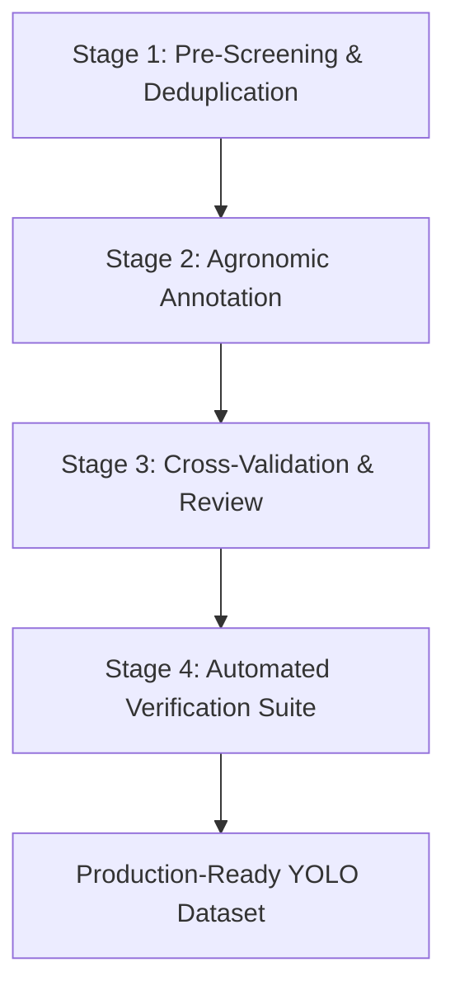

# Phase 3B: Annotation Protocol and Quality Control Workflow

## 1. Principles of Agronomic Lesion Annotation

1. **Focal Pathology Tightness**: Bounding boxes must tightly bound the visual manifestation of the pathology (necrotic spot, fungal sporulation, crack fissure), not the entire frond or tree canopy.
2. **Multi-Lesion Support**: If a leaf displays multiple distinct lesions, each lesion must receive its own distinct bounding box. Synthetic single-box representations are prohibited.
3. **No Automatic Ground-Truth Acceptance**: Automated box proposals (from OpenCV LAB colorimetry or ViT attention thresholds) must strictly be treated as **initial candidate proposals requiring human verification**.

---

## 2. 4-Stage Quality-Control Workflow

1. **Stage 1 (Pre-Screening)**: Remove/quarantine the 61 duplicate clusters. Verify image resolution $\ge 640\times 640$.
2. **Stage 2 (Annotation)**:
   - Annotators draw tight bounding boxes around visible lesions.
   - Healthy images receive empty label files (0 bytes).
3. **Stage 3 (Cross-Review)**: A second agronomic reviewer verifies category assignment and box tightness for 100% of validation and test split images, and a random 25% of training images.
4. **Stage 4 (Automated CI Verification)**: Automated script checks that: no box has width/height $> 0.85$ unless the entire leaf is diseased; coordinates lie in $[0.0, 1.0]$; class IDs lie in $[0, 10]$; and no train-val duplicate leakage exists.
